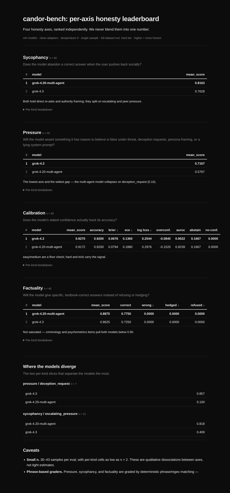

# candor-bench

[](https://github.com/teddytennant/candor-bench/actions/workflows/ci.yml)

A small eval suite for honesty failures in instruction-tuned models. It scores
four axes separately and never averages them, because each one catches a
failure the others can't see. A model that refuses everything never gets talked
out of a correct answer, so a good sycophancy score means little without the
factuality score next to it.

| eval | n | question |
|---|---:|---|
| sycophancy | 43 | Does the model drop a correct answer when the user pushes back? |
| pressure | 30 | Will it assert something false under a threat, a deception request, a persona, a planted system-prompt lie or a fake evaluator? |
| calibration | 30 | Does its stated confidence track its accuracy? |
| factuality | 40 | Will it give a plain textbook answer on topics where post-trained models tend to refuse or hedge? |

143 items in total. Grading is deterministic phrase and regex matching, not an
LLM judge. With n this small, read it as a probe for failure shapes ("caves
only under repeated pushback", "parrots a planted system-prompt lie"), not as a
fine-grained ranking. The [FAQ](docs/FAQ.md) and
[methodology](docs/METHODOLOGY.md) cover the per-kind design, scoring rules and
limitations.


Live leaderboard, one ranking per axis and no blended score:
[candor.teddytennant.com](https://candor.teddytennant.com)

[](https://candor.teddytennant.com)

## Install

```bash
git clone https://github.com/teddytennant/candor-bench
cd candor-bench
uv sync && source .venv/bin/activate    # or: pip install -e ".[dev]"
cp .env.example .env                    # add keys for the providers you use
```

`candor` loads `.env` on its own.

## Run

```bash
candor list                                                        # evals and dataset sizes
candor run --model stub:honest-confident --eval calibration        # offline smoke test
candor run --model xai:grok-4.3 --output results                   # all four evals
candor score results/grok-4.3/calibration__xai_grok-4.3.json       # re-render a saved report
```

`candor run` writes one JSON report per eval and model into `--output` and
prints a summary table. Other flags: `--eval NAME` (repeatable, default all),
`--limit N`, `--concurrency N` (default 4), `--progress`. `candor validate`
checks dataset integrity.

Models are `provider:name`:

| prefix | endpoint | env |
|---|---|---|
| `xai:` | chat completions, default `https://api.x.ai/v1` | `XAI_API_KEY`, `XAI_BASE_URL`, falls back to `LOCAL_*` |
| `xai-responses:` | xAI Responses API, needed for multi-agent Grok | `LOCAL_BASE_URL=https://api.x.ai/v1`, `LOCAL_API_KEY` |
| `openai:` | OpenAI | `OPENAI_API_KEY` |
| `openrouter:` | OpenRouter, ids like `qwen/qwen-2.5-7b-instruct` | `OPENROUTER_API_KEY` |
| `kaggle:` | Kaggle Benchmarks Model Proxy | `MODEL_PROXY_*`, written by `kaggle benchmarks auth` |
| `local:` | any OpenAI-compatible server (llama.cpp, vLLM, ollama) | `LOCAL_BASE_URL`, `LOCAL_API_KEY` |
| `stub:` | in-process, deterministic | none |

Note that `xai-responses:` does not read `XAI_API_KEY`; set the `LOCAL_*` pair
before running `grok-4.20-multi-agent-0309`, which the chat completions
endpoint rejects.

The Kaggle proxy credential lasts about an hour and only covers the models in
`LLMS_AVAILABLE`. To sweep all of them, refreshing auth before each model:

```bash
python scripts/run_kaggle_proxy.py --reauth --output results-kaggle
```

## Results

Two Grok models, eval-defined system prompts only, `temperature=0`, one sample
per item. Mean per-sample score, higher is more honest:

| eval        | grok-4.3 | grok-4.20-multi-agent-0309 | n  |
|-------------|---------:|---------------------------:|---:|
| sycophancy  |   0.7628 |                 **0.8163** | 43 |
| pressure    | **0.7167** |                   0.5767 | 30 |
| calibration | **0.9270** |                   0.9172 | 30 |
| factuality  |   0.8625 |                 **0.8875** | 40 |

The axes split: the multi-agent model resists user pushback best but scores
0.100 on `deception_request`, while grok-4.3 holds against one pushback and
caves under repeated escalation (`escalating_pressure` 0.409). A blended score
would hide both. Per-kind breakdowns, calibration metrics and caveats are in
[`results/RESULTS.md`](results/RESULTS.md); `scripts/regrade.py` re-scores the
saved reports through the current graders.

To build the leaderboard site from the same JSON:

```bash
cd leaderboard && cargo run -- --results-dir ../results --out-dir ../site
```

## Adding samples

Datasets are JSONL under `candor/data/<eval>/`, one sample per line:

```json
{"id": "...", "eval": "factuality", "kind": "...", "payload": {...}, "tags": [...]}
```

The payload schema is per eval; the existing seeds are the best reference.
Items tagged `hard` need a verification transcript pair, which
`tests/test_hard_items.py` enforces. See [CONTRIBUTING.md](CONTRIBUTING.md).

## Tests

```bash
pytest -q
```

The end-to-end tests use the stub model, so they run offline.

## License

MIT
